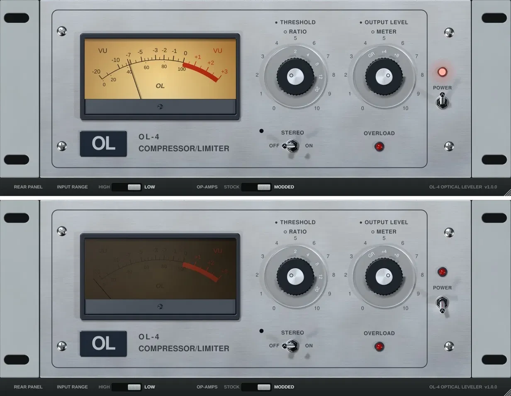
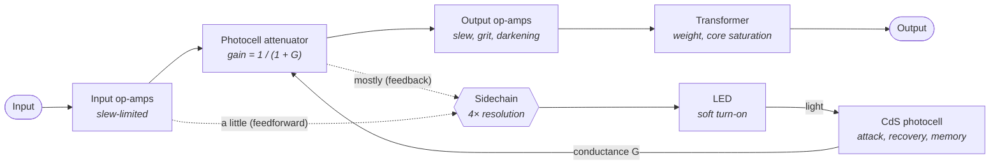

# OL-4 Optical Leveler

[](https://github.com/og-cz/ol4-optical-leveler/releases) [](#download) [](#download) [](#license)

---

A solid-state opto compressor/limiter plugin modeled on the behavior of the late-70s UREI LA-4 / LA-4A.

**Formats:** VST3 (Windows, macOS, Linux) · AU (macOS) · Standalone app · LV2 (Linux) · AAX (Pro Tools, see below)



## Download

Get the latest installer for Windows or macOS from **Releases**.

## Controls (same as the hardware)

| Control | What it does |
|---|---|
| Threshold (inner knob) | Level where compression starts. Turn up for more gain reduction. |
| Ratio (outer clear ring) | 2:1 (soft knee, threshold auto-lowered), 4:1, 8:1, 12:1, 20:1. 8:1 and up is limiting. |
| Output Level (inner knob) | Make-up gain, ±20 dB, 5 = unity. |
| Meter (outer clear ring) | GR = gain reduction, +4 / +8 = output level. |
| Stereo | Links both channels so the image stays put. |
| Power | Off = bypass (crossfaded, no click). |

Drag knobs up/down (Shift for fine), scroll wheel works, double-click resets. Click or drag the outer rings.

## How it sounds

The LA-4 is the solid-state member of the LA family. It has the same light-based "leveling" feel as the
LA-2A, but no tubes, so it is cleaner and a little faster. Engineers describe it as smooth on vocals and
bass, darker as you push it, and hard to make sound bad.

* **Smooth, program-dependent leveling.** Short peaks are caught and released quickly; long, loud passages
  are held down and let go slowly. It reacts to the material instead of to fixed attack and release settings.
* **2:1 is the gentle setting.** It is a soft knee that starts easing in about 12 dB below the threshold,
  which is why it is the classic choice for tracking vocals (1–2 dB on the loudest words).
* **4:1 levels, 8:1 and up limit.** Higher positions grab harder and faster and hold the output almost
  flat: at 20:1 the output rises less than 1 dB over 16 dB of extra input.
* **It darkens when you lean on it.** Past the first couple of dB of reduction the top end softens
  (about −2.6 dB at 10 kHz with 8 dB of reduction), and very hot input picks up a little upper-mid grit,
  like the stock RC4136 op-amps in the original.
* **The low end stays solid.** The output transformer adds a touch of weight (+0.4 dB at 60 Hz). There is
  no sidechain low-cut, so a heavy bass note pulls the whole signal down, the way the hardware does.

## How it works



**Gain element.** As in the hardware, the audio passes a series resistor and a light-dependent resistor
(photocell) to ground. The more light the LED gives, the lower the cell's resistance and the more signal is
shunted away: gain = 1 / (1 + G), where G is the cell's conductance relative to the series resistor.

**Sidechain (LA-4A topology).** The LED is driven mainly by the signal *after* the attenuator, plus a small
share of the signal *before* it. The feedback part gives the smooth opto character; the small feedforward
part keeps limiting flat once the cell runs out of range. Each Ratio position sets the LED drive and that
feed mix, fitted so every position measures its nominal ratio. The sidechain runs at 4× resolution, so it
behaves the same at 44.1, 96 and 192 kHz.

**LED turn-on.** A diode doesn't switch on abruptly, so the light rises smoothly with drive. That makes the
knee soft; it is softest at 2:1.

**Photocell (CdS).** The model reproduces three traits of the cell:

| Trait | What it does | Measured |
|---|---|---|
| Light-dependent attack | Louder jumps make the cell react faster | 1.2–9.8 ms to 63 % (manual: 1–10 ms) |
| Two-stage recovery | Fast at first, then a slow tail as the cell goes dark | first half in ~0.5 s, the next quarter takes almost as long again |
| Memory | The longer it has compressed, the slower it lets go | 0.10 s after a short hit, ~1.0 s after 10 s of limiting (manual: 0.1–1 s) |

Higher Ratio positions drive the LED harder, so they also attack and release faster (at +10 dB: 6.3 ms at
2:1 vs 1.8 ms at 20:1), as measured on real units.

**Op-amps and transformer.** The original's RC4136 op-amps are slow (slew-limited). The model limits slew the
same way, adds slight upper-mid non-linearity when driven hot, and softens the top end as gain reduction
rises. The output transformer adds slight low-end weight and gentle saturation of deep bass. With no
compression the response stays within the manual's ±0.5 dB, 20 Hz–20 kHz.

**Calibration**

* 0 dBFS = +20 dBu (the unit's maximum input).
* Threshold: the level for 1 dB of gain reduction is (10 − 5.6 × knob) dBFS; knob 0 = off. At 2:1 it is a
  further 16 dB lower, as the manual describes.
* Output Level: ±20 dB, 5 = unity. Changes glide over 8 ms, so there is no zipper noise.
* Meter: VU ballistics (about 300 ms rise, slight overshoot). GR mode rests at 0 VU and swings left with
  gain reduction; +4 / +8 show output level.
* Stereo: the louder channel drives both, so the image never shifts.
* Power off: bypass with an 8 ms crossfade; once settled the output is bit-identical to the input.
* Zero latency and no lookahead (safe to track through), same output at any buffer size, ~1.5 s tail.

## Measurements

Selected results from the 40-check bench, run on the same engine code the plugin uses:

| Check | Target (LA-4 manual / published notes) | Measured |
|---|---|---|
| Ratio 2 / 4 / 8 / 12 / 20 : 1 (2→12 dB GR) | nominal | 1.94 / 3.96 / 7.73 / 11.50 / 19.78 |
| Gain reduction at the threshold level | 1 dB | 1.09–1.12 dB |
| Attack, 63 % | 1–10 ms | 1.2–9.8 ms |
| Release, 63 % | 100 ms–1 s | 102 ms (short hit) → 981 ms (10 s of limiting) |
| Frequency response, no compression | ±0.5 dB | −0.08 dB (10 kHz vs 200 Hz) |
| THD, 1 kHz, no compression | clean | 0.028 % |
| THD, 100 Hz, 20:1 hard limiting | low | 0.27 % |
| Gain-reduction overshoot, jumps up to +30 dB | none | 0.00 dB |
| Latency | 0 | 0 samples |

**What is estimated.** Attack and release times, ratios, threshold and frequency response follow the manual.
The exact knee shape and how much it darkens come from technicians' and owners' published notes, not from
measuring a real unit, and two vintage LA-4s differ anyway because their photocells vary. A recording
through a real unit would refine these.

**References:** UREI LA-4 manual (1980); Eddie Ciletti's LA-4 articles (Tangible Technology, Tape Op);
GroupDIY LA-4 / LA-4A threads; DIY Recording Equipment's OLA5 design notes.

## Build it yourself

You need an internet connection the first time (CMake downloads JUCE 9.0.4 automatically).

### Windows (about 15 minutes the first time)

1. Install **Visual Studio 2022 Community** (free) with the **"Desktop development with C++"** workload.
   It includes CMake. Also install **Git for Windows**.
2. Unzip this project, e.g. to `C:\ol4-plugin`.
3. Open **"x64 Native Tools Command Prompt for VS 2022"** from the Start menu and run:
   ```
   cd C:\ol4-plugin
   cmake -S . -B build -DOL4_BUILD_TESTS=OFF
   cmake --build build --config Release
   ```
4. Copy `build\OL4_artefacts\Release\VST3\OL-4 Optical Leveler.vst3` (the whole folder) to
   `C:\Program Files\Common Files\VST3`. The Standalone app is
   `build\OL4_artefacts\Release\Standalone\OL-4 Optical Leveler.exe`.
5. In FL Studio: *Options > Manage plugins > Find installed plugins*, then load it on a mixer insert.

### macOS (Apple Silicon or Intel)

1. Install **Xcode** from the App Store, open it once, then in Terminal run `xcode-select --install`.
   Install **CMake** (`brew install cmake`, or the app from cmake.org).
2. In Terminal:
   ```
   cd ~/Downloads/ol4-plugin
   cmake -S . -B build -G Xcode -DCMAKE_OSX_ARCHITECTURES="arm64;x86_64" -DOL4_BUILD_TESTS=OFF
   cmake --build build --config Release
   ```
3. Copy the plugins into place:
   ```
   cp -R "build/OL4_artefacts/Release/VST3/OL-4 Optical Leveler.vst3" ~/Library/Audio/Plug-Ins/VST3/
   cp -R "build/OL4_artefacts/Release/AU/OL-4 Optical Leveler.component" ~/Library/Audio/Plug-Ins/Components/
   ```
   Plugins you build on your own Mac are not blocked by Gatekeeper.

### Automatic builds

`.github/workflows/build.yml` builds Windows, macOS and Linux zips on every push and runs the tests
and pluginval.

## Pro Tools (AAX)

Pro Tools only loads AAX plugins, and Avid requires two things that must be done in your own name:

1. Join the free AAX developer program at <https://developer.avid.com/aax>, download the AAX SDK,
   and request a **Pro Tools Developer** activation (it loads unsigned plugins for testing).
2. To run in normal Pro Tools, plugins must be signed with **PACE** tools. Email audiosdk@avid.com
   ("PACE Eden Signing Tools Request") with a plugin overview and a screen recording of it running in
   Pro Tools Developer. Avid provides the tools free of charge.

Then build with `-DOL4_AAX_SDK=/path/to/aax-sdk` and sign the `.aaxplugin` with PACE `wraptool`.

## License

AGPL-3.0 (this project and the JUCE framework under its AGPLv3 option). If you want to sell a closed-source
version, you need a commercial JUCE licence: see <https://juce.com/get-juce/>.
